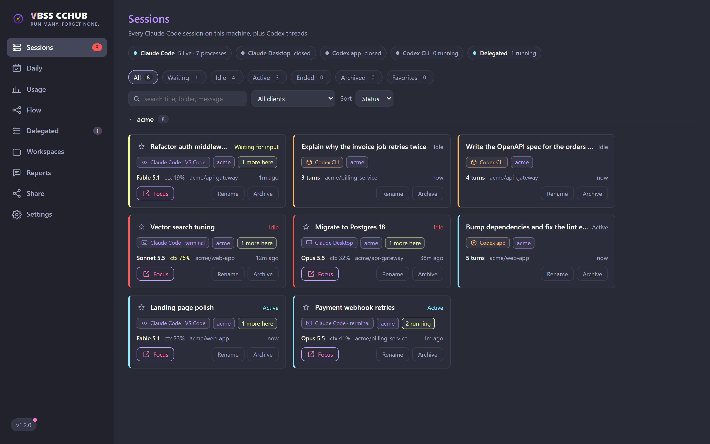

# VBSS CCHUB

A local hub for running many coding agents in parallel. Claude Code sessions report start,
prompt, needs-a-decision, stop and subagents through hooks; Codex CLI and Codex app threads
are read from their rollouts. The hub shows them on one board, tells you which ones need you,
shows what burns your tokens and how much of your plan is left, and lets any agent delegate
work into your workspaces through the `cchub` MCP server. Runs on `localhost`, reachable from
your phone on the same network.

Site: <https://cchub.vbss.io>



## Why

It started as a way to see which of many parallel Claude Code sessions was waiting on you.
It grew into the place where agents meet: Claude Code and Codex see each other, hand work off
into isolated worktrees through MCP, and report back, while you keep sessions, usage and
limits in view.

## Stack

| Layer | Tech |
| --- | --- |
| Back | Node + TypeScript + Express + SQLite (`better-sqlite3`) + SSE |
| Front | React + Vite |
| Desktop | Tauri v2 (tray, main window, docked widget, toast window), Node sidecar, `.msi` and per-user `.exe` |
| Landing | React + Vite standalone, prerendered (not bundled in Tauri) |

## Structure

```md
apps/
  server/     Express :4317 (hooks, SQLite, SSE, delegation, MCP) + share endpoint :4318
  ui/         React + Vite :1420 (main window, ?widget=1 docked widget, ?toast=1 toasts)
  desktop/    Tauri v2 shell: tray, windows, sidecar that runs the server
  landing/    React + Vite :1500, public landing page (cchub.vbss.io)
  vscode-ext/ optional VS Code helper (spike) for per-terminal focus
brand/        logo/icon source (radar mark, transparent) + app-icon (with background)
scripts/      release.mjs, dev-preview.mjs
```

## Session states

| Claude Code hook | State | Colour |
| --- | --- | --- |
| `SessionStart`, `UserPromptSubmit` | `active` | cyan |
| `Notification` (permission or decision) | `waiting` (needs you) | yellow |
| `Notification` (`idle_prompt`, "waiting for your input") | `idle` | red |
| `Stop` | `idle` (turn finished) | red |
| `SessionEnd` | `ended` | grey |
| `SubagentStart`, `SubagentStop` | status unchanged, subagent count updated | |

Codex threads get `active`, `idle` or `ended` from their rollout (`task_started` /
`task_complete` and the newest line timestamp). Sessions silent for longer than
`HUB_STALE_HOURS` are flagged inactive and left out of the counts.

Brand accents (logo, interactive highlights) are violet + amber; the status colours stay
semantic so the board reads at a glance. Default theme is Dracula, Midnight is in
Settings › Appearance.

## Headless sessions

Anything that shells out to `claude -p` (or the Agent SDK) inherits your global hooks, so a
`Stop` hook that summarizes the session would land on the board as a session of its own: one
card per run, no model, no tokens, a derived `<folder>-<hash>` name. The hook skips those:
`CLAUDE_CODE_ENTRYPOINT` is `sdk-*` for headless runs and `cli` for interactive ones.
`HUB_TRACK_SDK=1` reports them anyway.

Whatever still gets through (any session that never produced an assistant turn) sits behind
the **Empty** filter instead of the board, and the server drops it after
`HUB_EMPTY_TTL_HOURS`.

## Run (dev)

```bash
npm install
npm run dev          # server :4317 + ui :1420
# in another terminal, the desktop app:
npm run desktop:dev
# landing page (optional):
npm run dev -w @cch/landing   # :1500
```

Isolated preview with its own data folder and seeded sessions (does not touch your hub):

```bash
node scripts/dev-preview.mjs --seed   # hub :14317, ui :15173
```

Phone on the same network: `http://<machine-ip>:4317` (the server serves the front when
`HUB_STATIC_DIR` points at the ui build, see below).

## Set up the Claude Code hooks

Three ways (all idempotent; they touch only the hub's `notify.mjs` / `notify.sh` entries and
back up `settings.json.bak`):

1. **From the app**: Settings › Hooks › **Install hooks** (works in Tauri and in the
   browser/phone). The same button removes them. It detects WSL distros and installs the
   right hook in each one.
2. **CLI**: `node apps/server/hooks/configure.mjs install` (or `uninstall` / `status`).
3. **Manual**: copy from `apps/server/hooks/settings.example.json` into
   `~/.claude/settings.json`, adjusting the absolute path.

Registered events: `SessionStart`, `UserPromptSubmit`, `Notification`, `Stop`,
`SessionEnd`, `SubagentStart`, `SubagentStop`. On Windows the hook is `notify.mjs` (Node): it
reads the hook JSON from stdin, posts the status inline and hands the slower metadata to a
detached worker that does `POST /hook` with a 2 s timeout. If the hub is offline it fails
silently and never blocks Claude Code. It anchors the session on `CLAUDE_PID`, the env var
Claude Code gives its hooks.

## Focus a session

Clicking **Focus** (the card button, the project name, or a widget row) brings the
**window where the session already runs** (VS Code, Windows Terminal, etc.) to the front;
nothing new is opened. `POST /api/sessions/:id/focus`, runs on the host (app, widget and
phone).

How it works (no reliance on a fixed window title): `notify.mjs` runs inside the session's
process tree, so it walks up (`find-host-window.ps1`) to the first ancestor with a window, the
terminal or editor hosting Claude, and sends that PID (`hostPid`) to the hub. Focus brings that
PID's window forward. When one process owns several windows (e.g. VS Code), it disambiguates
by matching the session's folder name in the window title. The walk runs once per session
(cached in `~/.vbss-cchub/pids/`).

Honest limits: Windows Terminal has one window per process (focuses the window, not the
specific tab). Focus of a session running inside WSL is limited, see below.

## Docked widget

A second Tauri window, transparent and always on top, docked to the **left, right or top**
edge of the screen (Settings › Widget). Collapsed, it is a small tab with an arrow, a badge
with the sessions that need you and, when Limits is on, a weekly-limit ring per provider
(Claude, Codex; each can be turned off). Drag it along the edge to move it. Open it for two
tabs:

- **Sessions**: needs you, running, idle, delegated and recently done. Click a row to focus
  that session.
- **Usage**: today and last 7 days of tokens per provider, plus the 5-hour, weekly and
  per-model limits with reset countdowns.

The tray menu has **Open Hub**, **Show/hide widget** and **Quit**. Settings › Widget also
chooses the default tab and whether the widget starts with the app.

## Notifications

Per-event desktop notifications (session needs you, turn finished, task done or failed, and
more) with their own toast window stacked bottom-right; native Windows toasts are optional.
Settings › Notifications picks the events, which sessions notify and the channels.

## Usage and limits (opt-in)

Both live behind Settings › Features and stay off until you turn them on.

- **Usage**: tokens per day, project, session and model for Claude Code and Codex, split into
  cache reads, fresh input, cache writes and output, with context per message (p50 / p90 /
  max). Read from the transcripts already on disk (`~/.claude/projects`, Codex rollouts),
  deduplicated per message, and cached in `~/.vbss-cchub/usage-cache.json` so a restart does
  not rescan everything. Nothing is uploaded.
- **Limits**: how much of the plan is used, account-wide (usage from other machines counts).
  Claude: 5-hour, weekly and per-model windows from the same usage endpoint Claude Code uses,
  called with the Claude Code login already on the machine; the token is read in memory only,
  never logged, stored, refreshed or rotated; auth and rate-limit errors back off instead of retrying. Codex:
  the newest rollout's `rate_limits`, or live through `codex app-server` when **Codex live** is
  on. Refresh interval is configurable (1 to 60 minutes).

## Daily and session trail (opt-in)

Point Settings › Paths at a Markdown or Obsidian vault (the "second brain") and turn on:

- **Daily**: the day's note in your vault, rendered in the hub with a preview that keeps the
  file's indentation and filters tasks by state. Edits in the hub and in the vault mirror each
  other. **Plan today** walks three steps (close yesterday, confirm today, compose from your
  template, no tokens spent); **Refine with assistant** is optional and runs as a delegated
  task. Folder, template, headings and prompt are settings.
- **Session trail**: the hub summarizes each Claude Code session into key points in one file
  per day (light, medium or high detail) with a small model through your Claude Code, and
  appends its own events (delegations, reports) under `## Hub` in the same file.

## The hub for every agent

The desktop app runs the server with `HUB_DELEGATION=1`, which turns the hub into the place
where agents arrive and report:

- **Workspaces** are discovered from your `.code-workspace` folder (the one a `wk` alias
  reads); the hub can create, edit and open them, and install the alias in bash or
  PowerShell.
- **Delegation**: Claude Code, Claude Desktop, Codex CLI and the Codex app register the hub as
  the `cchub` MCP server (Settings › Connections) and get `hub_overview`, `hub_workspaces`,
  `hub_delegate`, `hub_task`, `hub_continue`, `hub_report`, `hub_claim` and friends. Delegated
  runs start in the workspace context folder with every repo attached, show up as regular
  sessions, and can be followed, steered or cancelled from **Delegated**.
- **Isolation**: when a repo is busy, a task moves to its own git worktree and branch
  automatically and the origin session is told when to merge. Each task gets a block of 10
  ports (20000-29999) for dev servers and previews, and interactive sessions can claim files
  so delegated work keeps off them.
- **Flow**: workspaces, sessions, subagents and delegated tasks as one live map.
- **Reports** from any agent land in **Reports** and, with a vault linked, in the day's trail
  file (or `fontes/hub/<date>.md` when the trail is off).
- **Share**: a link (LAN, or public through ngrok, which the hub downloads and starts) that
  lets another person's assistant ask your Claude about a workspace and delegate work into it
  at a trust level you pick (Low read-only, Medium edits, High edits + safe shell, Total no
  blocks), with a key per link, expiry, rate limit, pause/revoke and a full log. Share runs
  carry a `PreToolUse` guard (`hooks/guard.mjs`) that enforces the trust level and keeps
  secrets out.
- **Autonomous by default**: delegated runs bypass permissions (Claude) and the sandbox
  (Codex) so nothing stops in "Needs you"; switch to safe mode in Settings. The app can start
  with Windows.

Details, security model, MCP tools and the thin CLI in `apps/server/DELEGATION.md`.

## Track many Claudes (WSL / another subscription / another machine)

Each session carries a `source` (env `HUB_SOURCE`, default = hostname). When there's more than
one origin, the card shows a `source` badge. WSL has no Node on the native `claude` binary's
path, so WSL sessions use `notify.sh` (curl) posting to `POST /hook/raw`. **Install hooks**
sets this up for each WSL distro; the manual equivalent is:

```bash
HUB_SOURCE=wsl HUB_HOST_TARGET=<windows-ip-or-gateway> sh "/mnt/c/path/to/vbss-cchub/apps/server/hooks/notify.sh"
```

`notify.sh` resolves the Windows host via the default-route gateway when `HUB_HOST_TARGET`
is unset. `open/focus` of WSL paths is still limited; native Windows paths work best.

## Environment variables

### Server

| Var | Default | Purpose |
| --- | --- | --- |
| `HUB_PORT` | `4317` | Server port |
| `HUB_HOST` | `0.0.0.0` | Bind (LAN for phone) |
| `HUB_HOME` | user home | Home folder the hub reads Claude/Codex files from |
| `HUB_DATA_DIR` | `~/.vbss-cchub` | Where `hub.db` and the usage cache live |
| `HUB_STATIC_DIR` | unset | ui build to serve the front on the same port |
| `HUB_EMPTY_TTL_HOURS` | `12` | Drop sessions that never produced a turn after this long (`0` keeps them) |
| `HUB_STALE_HOURS` | `4` | Sessions silent for longer are flagged inactive and left out of the counts |
| `HUB_DELEGATION` | unset | `1` enables the delegation surface (the desktop app sets it) |
| `HUB_DELEGATION_TIMEOUT_MIN` | Settings value | Run timeout for delegated tasks (`0` = none) |
| `HUB_WORKSPACES_ROOT` | unset | Default folder of `.code-workspace` files (the Settings value wins) |
| `HUB_SECOND_BRAIN` | unset | Default vault root for Daily, trail and reports (the Settings value wins) |
| `HUB_EDITOR` | `code` | Command used to open workspaces |
| `HUB_CLAUDE_BIN` | `claude` | Claude Code CLI used by delegated runs and the trail |
| `HUB_CODEX_BIN` | newest `codex.exe` | Codex CLI used by the codex runner and live limits |
| `CODEX_HOME` | `~/.codex` | Where Codex sessions are read from |
| `HUB_CLAUDE_PROJECTS_DIR` | `~/.claude/projects` | Transcripts scanned by Usage |
| `HUB_CLAUDE_CREDENTIALS` | `~/.claude/.credentials.json` | Claude Code login read (in memory) for Limits |
| `HUB_CLAUDE_USAGE_URL` | Anthropic usage endpoint | Override for tests; only loopback URLs are accepted |
| `HUB_TRUSTED_ORIGINS` | unset | Extra browser origins allowed on `/delegation`, comma-separated |
| `HUB_SHARE_PORT` | `4318` | Share endpoint (links for other people's assistants; LAN and ngrok target) |
| `HUB_SHARE_HOST` | `0.0.0.0` | Bind address of the share endpoint |
| `HUB_NGROK_BIN` | auto | ngrok executable for Start tunnel (downloaded automatically when absent) |
| `HUB_URL` | `http://127.0.0.1:<HUB_PORT>` | Hub address used by the MCP server and the CLI |

### Hook

| Var | Default | Purpose |
| --- | --- | --- |
| `HUB_HOST_TARGET` | `127.0.0.1` (win) / gateway (wsl) | Hub host the hook posts to |
| `HUB_PORT` | `4317` | Hub port |
| `HUB_SOURCE` | hostname | Session origin label (e.g. `wsl`, `work-sub`) |
| `HUB_SKIP` | unset | `1` makes the hook exit without reporting |
| `HUB_TRACK_SDK` | unset | `1` also reports headless sessions (see above) |
| `HUB_HOOK_INLINE` | unset | `1` posts everything inline instead of through the detached worker |

### UI

| Var | Default | Purpose |
| --- | --- | --- |
| `VITE_HUB_URL` | `http://<host>:4317` | Override the server URL |

The context bar limit is inferred per model family (1M for Opus and Fable, 200k for Sonnet
and Haiku), and switches to 1M when a session goes past 200k.

## Release

```bash
npm run release -- 1.3.0
```

One command from a clean `main`, for a version greater than the current one: bumps every
manifest, builds the `.msi` and the per-user `.exe`, copies them to the stable and versioned
asset names, commits and pushes the bump, publishes the GitHub release with the notes from
the first entry of `changelog.json` (which must match the version and have a date), and
checks the public download URL. Write the `changelog.json` entry first; the app's What's new
and the landing read from it and from the latest release.

The landing always points to `releases/latest/download/VBSS-CCHUB-Setup.msi` and reads the
latest release for its version and highlights, so a release alone updates it. Landing changes
ship by pushing `main` to `prd`, which builds the image and dispatches the deploy.

## Known gaps

- **Mobile**: serving over the LAN works, but real-device layout and notifications over
  plain-http (secure-context limits Web Notification/AudioContext) still need validation.
- **WSL focus**: opening/focusing WSL paths is best-effort; native Windows paths work best.
- **Widget**: dragging across monitors with different scaling has not been validated on every
  setup; if the tab ends up off screen, pick the edge again in Settings › Widget.

## Support

CC Hub is free and MIT licensed. If it saves you time, you can help keep it maintained:

- Buy me a coffee: [buymeacoffee.com/vbss.io](https://www.buymeacoffee.com/vbss.io)
- GitHub Sponsors: [github.com/sponsors/vbss-io](https://github.com/sponsors/vbss-io)

## License

[MIT](LICENSE)
